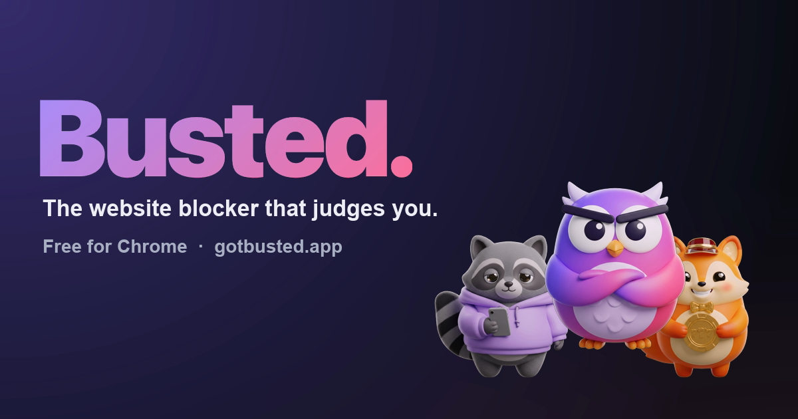
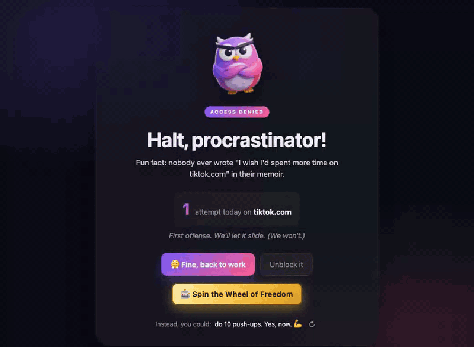
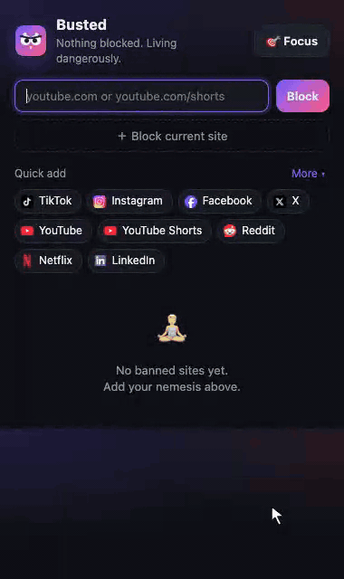
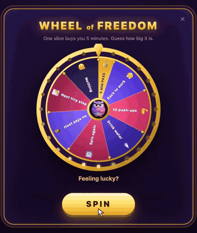
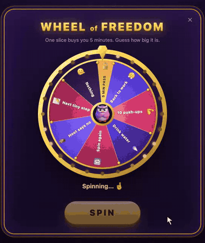

<p align="center">
  <a href="https://gotbusted.app"></a>
</p>

<p align="center">
  A website blocker for Chrome, small enough to read before you trust it.<br>
  Block sites always, on a schedule, or after a daily limit. Open one anyway and an owl catches you.
</p>

<p align="center">
  <a href="https://chromewebstore.google.com/detail/hboldmfdfgijnjjndagdnalehfjngphg"></a>
</p>

<p align="center">
  <a href="https://chromewebstore.google.com/detail/hboldmfdfgijnjjndagdnalehfjngphg"></a>
  
  
  <a href="LICENSE"></a>
</p>

<p align="center">
  <a href="#why-another-blocker">Why</a> ·
  <a href="#what-it-does">What it does</a> ·
  <a href="#the-wheel-of-freedom">The wheel</a> ·
  <a href="#install">Install</a> ·
  <a href="#how-it-works">How it works</a> ·
  <a href="https://gotbusted.app">gotbusted.app</a> ·
  <a href="https://www.youtube.com/watch?v=rmgBHqof8_Y">Video</a>
</p>

<p align="center">
  
</p>

<p align="center"><i>Go on, click "Unblock it".</i></p>

## Why another blocker

A website blocker sees the address of every tab you open. The Chrome Web Store has plenty of them, and I had no way to tell what most of them do with that. So I wanted one small enough to check in one sitting.

- **Plain JavaScript you can read.** No build step, no libraries, nothing minified.
- **No host permissions.** Busted sees the address of a tab. It cannot read or change what is on the page.
- **No network requests.** This prints nothing:
  ```sh
  grep -rnE "fetch\(|XMLHttpRequest|WebSocket|sendBeacon" extension/
  ```
- **No account, no analytics.** Your list, schedules and counters stay in `chrome.storage.local` on your device. So do Insights, if you turn them on.
- **The store version is built from this code.** `tools/package.sh` zips the `extension/` folder as it is, and that zip is what I upload. The tag [`v1.3.1`](https://github.com/dlesnic/busted/tree/v1.3.1) is the exact source of the version in the store today.

Two things open a web page in your browser. Removing the extension opens a short "why did you leave" page on gotbusted.app, with the version number in the address and nothing else. The "Rate Busted" button opens the Chrome Web Store.

## What it does

<table>
  <tr>
    <td width="36%" valign="top">
      
    </td>
    <td valign="top">

**A whole site, or one part of it.** `youtube.com/shorts` blocks Shorts and leaves the rest of YouTube alone. `reddit.com/r/all` works the same way.

**47 sites in Quick add.** From TikTok and Instagram to Hacker News and Steam. Subdomains are covered, so `youtube.com` also blocks `m.youtube.com`.

**Schedules.** Pick the days and the hours. A window that ends before it starts runs overnight, like 23:00 to 07:00.

**Daily limits.** 15, 30, 60 or your own number of minutes a day. Only time with the site in the tab in front of you counts, and only while you are at the computer. When the minutes run out, the site is blocked until midnight.

**Focus sessions.** 25, 50 or up to 180 minutes. Block your list, or block everything except the few sites you need. There is no pause, and ending early takes a 60 second wait. When the session ends, blocked tabs go back to the page they were on.

**Insights, if you turn them on.** A page that shows where your browsing time goes: time per site, work against distractions, day by day, and the hours when you drift. It shows when each site was open, suggests blocks (a daily limit, a block for the hours you usually drift, or a full block for a site you keep checking), and every site has its own Block and Limit buttons. The toolbar icon shows today's time on distracting sites. Only site names and times are kept, in your browser, for 90 days. It is off until you switch it on, and you can pause it or delete everything.

**No way around it through an open tab.** Tabs already on a site you just blocked are sent to the blocked page. The Back button and cached pages are covered too.

  </td>
  </tr>
</table>

## The Wheel of Freedom

Chrome's own error page would do the job. Busted shows Hoot, who counts how many times you tried today and has an opinion about it. And once every 20 minutes, per site, you get to spin.

<table>
  <tr>
    <td width="50%" align="center"></td>
    <td width="50%" align="center"></td>
  </tr>
  <tr>
    <td align="center">Most slices send you back to work, or to do 10 push-ups.</td>
    <td align="center">One thin slice is a real 5 minute pass. Lucky the fox takes care of Hoot.</td>
  </tr>
</table>

The pass slice is drawn smaller than your real chance of hitting it. The actual odds are in [`blocked.js`](extension/blocked/blocked.js), if you want to spoil it.

## Install

**From the store:** [Busted on the Chrome Web Store](https://chromewebstore.google.com/detail/hboldmfdfgijnjjndagdnalehfjngphg). Free, no account.

**From this code:**

1. Download or clone this repository.
2. Open `chrome://extensions` and turn on Developer mode.
3. Click "Load unpacked" and pick the `extension` folder.

Tested in Chrome and Chromium. I have not tried Edge, Brave or other Chromium browsers.

## How it works

```
extension/
  manifest.json
  background/service-worker.js   turns the list into block rules, checks schedules every minute,
                                 counts daily-limit time, sends blocked tabs to the blocked page
  popup/                         the popup: the list, the schedule and limit editor, focus sessions
  blocked/                       the blocked page and the wheel
  dashboard/                     the Insights page
  lib/shared.js                  the rules: is this address blocked right now
  lib/presets.js                 the Quick add sites
  lib/categories.js              which sites count as work and which as distraction
  lib/insights.js                the Insights sums and advice
  icons/  art/                   icons and mascot art
tests/unit.mjs                   tests for the Insights sums
tests/e2e.mjs                    end-to-end tests
tools/package.sh                 builds the store zip
```

1. The popup saves your list to `chrome.storage.local`.
2. The service worker rebuilds the block rules from it: one `declarativeNetRequest` rule per entry that is active right now. Chrome itself stops the request before the site loads.
3. A tab listener then replaces Chrome's error page with the blocked page. It also catches what never reaches the network, like the Back button and navigation inside a page that is already open.
4. An alarm fires every minute for schedules. Separate alarms fire at the moment a pass, a focus session or a daily limit ends.

### Permissions

| Permission | Why |
|---|---|
| `declarativeNetRequest` | Blocks requests for the sites on your list |
| `tabs` | Reads the address of open tabs, to send a tab on a blocked site to the blocked page and to count time for daily limits. Nothing is sent anywhere. With Insights turned on, the site name (like `youtube.com`) and the time on it are saved on your device; full addresses never are |
| `storage` | Saves your list and settings on your device |
| `alarms` | Wakes the extension for schedules, passes, limits and focus sessions |
| `favicon` | Shows site icons from Chrome's own local icon cache |
| `idle` | Tells whether anyone is at the computer, so time is not counted for a page left open while you are away |

## Tests

57 end-to-end tests drive the real extension in Chromium: the popup, the blocked page, the wheel, focus sessions, daily limits and Insights. They take about 5 minutes. 37 unit tests cover the Insights sums and suggestions.

```sh
npm install
npx playwright-core install chromium
npm test
```

`npm run build` makes the zip for the Chrome Web Store.

## Feedback

Found a bug, or a site that should be in Quick add? [Open an issue](https://github.com/dlesnic/busted/issues/new/choose). Pull requests are welcome as long as they add no permissions and no network requests.

If Busted helps you, a [review on the Chrome Web Store](https://chromewebstore.google.com/detail/hboldmfdfgijnjjndagdnalehfjngphg/reviews) does more for it than a star here. The list of changes is in [CHANGELOG.md](CHANGELOG.md).

## License

The code is MIT, see [LICENSE](LICENSE). The Busted name, the icon and the mascot art in `extension/art/` are not covered by it. The site icons in `extension/icons/sites/` belong to their owners.
